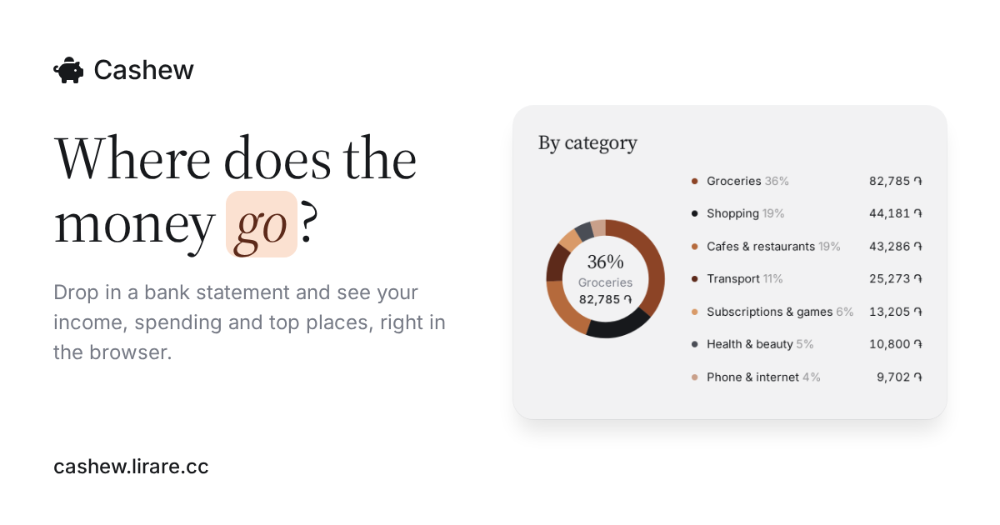

# Cashew

**Where does the money go?** Drop in a bank statement and Cashew shows your
income, spending and top places — right in the browser.

**Live:** [cashew.lirare.cc](https://cashew.lirare.cc)

## What it does

- Reads bank statements in `.xlsx`, `.xls` or `.csv` — several months at once
- Sorts transactions into categories and shows a breakdown by category
- Top places you spend at, spending by day, and a searchable list of all transactions
- Savings goal: estimates how long a target amount will take at your pace
- Russian, English and Armenian interface; light and dark theme

## Privacy

Files are processed entirely in your browser and never uploaded anywhere.
Data is kept only in your browser's local storage.

## Tech

Plain HTML, CSS and JavaScript — no build step, no server.
[SheetJS](https://sheetjs.com) reads the spreadsheets. Hosted on GitHub Pages.

## License

[MIT](LICENSE) © 2026 Knarik Harutyunyan.
The bundled `vendor/xlsx.full.min.js` is SheetJS Community Edition, under its own
Apache 2.0 license.
